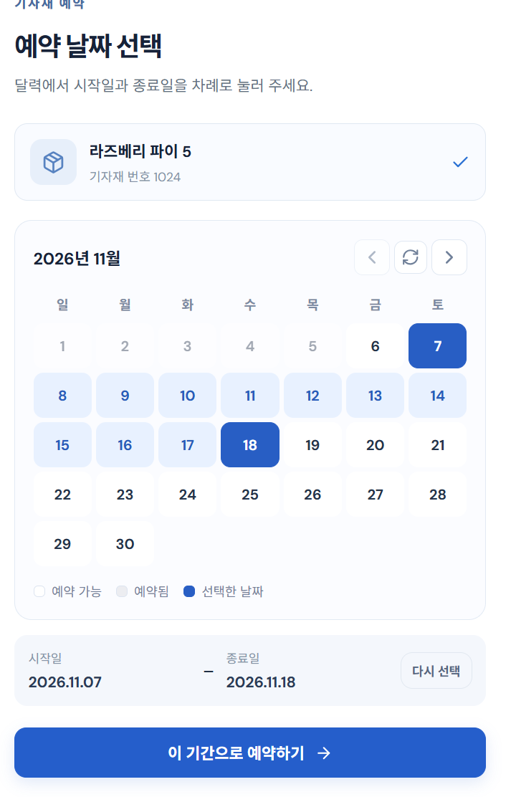
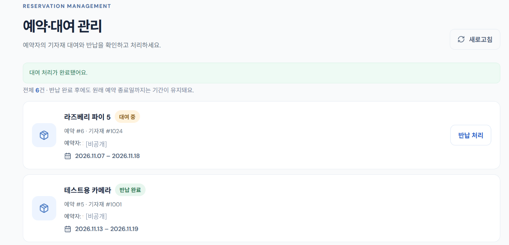

# LabGear

**학과 기자재 예약·대여 관리 서비스**

[](https://github.com/gduck0/labgear-service/actions/workflows/ci.yml)

LabGear는 학과 실습과 캡스톤디자인에 사용하는 기자재를 학생이 예약하고, 관리자가 대여·반납을 처리하는 웹 서비스입니다.

동시 요청에서 발생하는 데이터 정합성 문제를 재현하고, **문제의 특성에 따라 비관적 락·DB 제약조건·JPA 저장 방식을 구분해 적용했습니다.**

- **개발 기간:** 2026.09 ~ 진행 중
- **형태:** 개인 프로젝트
- **현재 상태:** 핵심 기능 및 CI 구축 완료, 공개 배포 전

## 1. 주요 기능

**기자재 조회 → 기간 예약 → 관리자 대여 인계 → 반납 확인**

| 구분 | 주요 기능 |
| --- | --- |
| 학생 | 기자재 검색·조회, 예약 현황 확인, 예약 생성·취소, 내 예약 및 대여 상태 조회 |
| 관리자 | 기자재 등록·수정·삭제, 전체 예약 조회, 대여·반납 처리 |

Spring Security 기반 세션 인증과 역할별 접근 제어를 적용했습니다. 비밀번호는 BCrypt로 해시 처리하며, 본인 예약 조회·취소는 인증된 계정을 기준으로 처리합니다.

예약 상태는 `ACTIVE → CANCELED` 또는 `ACTIVE → RENTED → RETURNED`로 변경됩니다.

취소·반납 후에도 예약 기록은 보존합니다. 현재 정책상 취소된 예약 기간은 재예약할 수 있고, 반납 완료된 예약 기간은 중복 검사 대상에 남습니다.

### 서비스 화면

<table>
  <thead>
    <tr><th>학생 — 예약 기간 선택</th><th>관리자 — 대여·반납 관리</th></tr>
  </thead>
  <tbody>
    <tr>
      <td align="center" valign="top"></td>
      <td align="center" valign="top"></td>
    </tr>
  </tbody>
</table>

<sub>테스트 데이터로 촬영했으며 계정 정보는 가렸습니다.</sub>

## 2. 데이터 정합성 문제와 기술적 선택

| 문제 | 지켜야 하는 조건 | 선택한 해결책 |
| --- | --- | --- |
| 동시 예약 생성 | 동일 기자재의 예약 기간 중복 방지 | 기자재 행 비관적 락 + 트랜잭션 |
| 동일 ID 기자재 등록 | 중복 등록 및 기존 데이터 변경 방지 | `persist()` + PK 제약 + 409 응답 |
| 동일 기자재 이중 대여 | 한 기자재의 동시 대여는 최대 한 건 | 기자재 행 잠금 + 대여 상태 검사 |

### 2.1. 예약 생성 — 조회 후 저장 사이의 경쟁 조건

초기 예약 로직은 `중복 기간 조회 → 예약 저장` 순서였습니다. 순차 요청에서는 정상 동작했지만, 두 요청이 서로의 저장 결과를 확인하기 전에 중복 검사를 통과하면서 동일 기간의 예약이 중복 저장되는 문제를 재현했습니다.

해결 과정에서는 **아직 생성되지 않은 예약 행 대신, 두 요청이 공통으로 접근하는 기자재 행**을 잠금 기준으로 선택했습니다.

`PESSIMISTIC_WRITE`로 기자재 행을 잠그고, `READ_COMMITTED` 트랜잭션 안에서 중복 검사와 저장을 수행하도록 변경했습니다.

두 요청의 동시 예약 시나리오를 30회 반복해 매회 `201 Created`·`409 Conflict` 응답과 최종 예약 한 건을 확인했습니다. 별도 테스트로 다른 기자재 예약 및 일반 조회가 불필요하게 차단되지 않는지도 검증했습니다.

같은 기자재의 예약 생성은 기간이 겹치지 않더라도 잠금을 순서대로 획득합니다. 이는 기자재 단위 정합성을 보장하기 위해 수용한 비용입니다.

[PR #8 — 동시 예약 중복 방지](https://github.com/gduck0/labgear-service/pull/8) · [동시 예약 테스트](src/test/java/com/gduck0/labgear/ReservationConcurrentApiIntegrationTest.java)

### 2.2. 기자재 등록 — 비관적 락 대신 PK 제약을 활용한 이유

예약 동시성 개선 이후 다른 기능의 정합성을 점검하면서, 두 관리자가 같은 기자재 ID로 서로 다른 이름을 동시에 등록하는 문제를 확인했습니다.

수정 전 60회 테스트에서는 정상적인 성공·충돌 응답 조합이 한 번도 발생하지 않았습니다.

| 결과 | 횟수 |
| --- | ---: |
| 정상적인 `201`·`409` 조합 | 0회 |
| 두 요청 모두 `201` | 6회 |
| 미처리 예외 발생 | 54회 |

[수정 전 재현 로그](https://github.com/gduck0/labgear-service/actions/runs/41377287168)

예약 생성에서는 서로 다른 행의 날짜 구간 중복을 막아야 했지만, 기자재 등록에서는 **동일 ID의 유일성을 기존 DB 기본키 제약으로 보장할 수 있었습니다.**

따라서 새로운 비관적 락을 추가하지 않고 다음과 같이 개선했습니다.

- **`EntityManager.persist()`**: 기존 엔티티 상태를 병합하는 경로를 피하고 신규 등록 의도를 명확히 함
- **DB 기본키 제약**: 동일 ID의 중복 INSERT 방지
- **트랜잭션**: `persist()`를 통한 신규 저장과 커밋의 경계 설정
- **MySQL `1062` → HTTP `409`**: 중복 키 충돌을 API 오류 응답으로 변환

`persist()` 변경 이후에도 충돌 응답 처리가 부족해 테스트가 실패했습니다. 예외 처리를 추가한 후 동시 등록 60회 테스트를 통과했으며, **한 요청만 성공하고 성공한 요청의 데이터가 DB에 보존되는 것**을 확인했습니다.

[PR #9 — 기자재 등록 정합성 개선](https://github.com/gduck0/labgear-service/pull/9) · [동시 등록 테스트](src/test/java/com/gduck0/labgear/EquipmentConcurrentRegistrationIntegrationTest.java)

### 2.3. 이중 대여 — 개별 예약 상태와 기자재 전체의 정합성

서로 다른 기간의 예약이 각각 유효하더라도, 하나의 실물 기자재를 동시에 두 건의 `RENTED` 상태로 변경할 수는 없습니다.

기존에는 개별 예약 행의 상태만 확인했기 때문에 서로 다른 예약을 순차적으로 대여해도 둘 다 `RENTED`가 될 수 있었습니다.

이에 **동일 기자재의 기존 대여 여부를 검사하는 업무 규칙**을 추가하고, 두 요청이 검사를 동시에 통과하지 못하도록 기자재 행 비관적 락을 적용했습니다.

순차·동시 이중 대여 거부, 반납 이후 다음 대여 성공, 최종 DB 상태를 검증했습니다.

[PR #15 — 이중 대여 방지](https://github.com/gduck0/labgear-service/pull/15) · [대여·반납 통합 테스트](src/test/java/com/gduck0/labgear/ReservationRentalReturnIntegrationTest.java)

### 상세 기술 기록

**[동시성·정합성 문제 해결 시나리오](docs/concurrency-scenarios.md)**

각 문제의 재현 조건, 선택 근거, 잠금 순서, 테스트 및 한계를 별도로 정리했습니다. 기자재 삭제와 예약 생성의 경쟁, 잠금 범위 검증도 포함합니다.

## 3. 테스트와 CI

JUnit 5, Spring Boot Test, MockMvc와 실제 MySQL 테스트 DB를 사용합니다.

동시 요청은 별도 스레드와 독립된 트랜잭션에서 처리하며, **HTTP 응답뿐 아니라 최종 DB 상태와 기존 데이터 보존 여부**를 함께 검증합니다.

인증·인가, 기자재 CRUD, 예약 취소·상태 전이 등 기본 기능도 통합 테스트에 포함했습니다.

GitHub Actions는 `main`에 대한 push와 `main`을 대상으로 하는 Pull Request에서 실행됩니다.

| 작업 | 실행 환경 |
| --- | --- |
| Backend Tests | Java 21, MySQL 8.4, `./gradlew test` |
| Frontend Build | Node.js 22, `npm ci` 및 `npm run build` |

[CI 설정](.github/workflows/ci.yml) · [main CI 성공 기록](https://github.com/gduck0/labgear-service/actions/runs/41607336845)

**검증 한계:** 동시 요청 테스트는 실제 MySQL을 사용하지만 모든 경쟁 구간의 실행 순서를 결정적으로 강제하지는 않습니다. 테스트 성공이 대규모 부하 성능이나 운영 환경의 완전한 안전성을 증명하지는 않습니다.

## 4. 기술 구성

| 영역 | 기술 |
| --- | --- |
| Backend | Java 21, Spring Boot 4.1.1, Spring MVC, Spring Data JPA, Spring Security |
| Database | MySQL 8.4 |
| Frontend | React 19, Vite 6 |
| Test | JUnit 5, MockMvc, Spring Boot Test |
| Build / CI | Gradle, npm, GitHub Actions |

**요청 처리 구조**

`React → Spring MVC → Service → Spring Data JPA → MySQL`

주요 도메인은 `Account`, `Equipment`, `Reservation`이며, 예약은 사용자와 기자재를 참조합니다.

## 5. 로컬 실행

**필요 환경:** Java 21, MySQL 8.4, Node.js 22

### 개발 DB 준비

```sql
CREATE DATABASE IF NOT EXISTS labgear
  CHARACTER SET utf8mb4;
```

현재 개발 설정은 로컬 MySQL의 `root` 계정과 `DB_PASSWORD` 환경변수를 사용합니다.

### 백엔드 실행

```bash
export DB_PASSWORD='로컬 MySQL 비밀번호'
./gradlew bootRun
```

### 프론트엔드 실행

```bash
cd frontend
npm ci
npm run dev
```

- Backend: `http://localhost:8080`
- Frontend: `http://localhost:5173`

개발 환경에서는 Vite의 `/api` 프록시를 사용합니다.

### 테스트 실행

테스트는 개발 DB와 분리된 `labgear_test`를 사용합니다. 로컬 MySQL에 전용 DB와 계정을 구성해야 합니다.

```sql
CREATE DATABASE IF NOT EXISTS labgear_test
  CHARACTER SET utf8mb4;

CREATE USER IF NOT EXISTS 'labgear_test'@'localhost'
  IDENTIFIED BY '테스트용 비밀번호';

GRANT ALL PRIVILEGES ON labgear_test.*
  TO 'labgear_test'@'localhost';
```

```bash
export LABGEAR_TEST_DB_PASSWORD='테스트용 비밀번호'
./gradlew test
```

[테스트 DB 설정](src/test/resources/application.properties)

CI에서는 MySQL 테스트 컨테이너와 계정을 자동 구성합니다. 일반 회원가입 계정에는 `USER` 역할이 부여되므로, 관리자 기능을 수동 검증할 때는 별도의 `ADMIN` 계정이 필요합니다.

## 6. 현재 한계와 후속 과제

LabGear는 실제 운영 사용자와 운영 실적이 없는 개인 프로젝트이며, 공개 배포 전 단계입니다.

- 공개 데모 배포 및 운영 환경의 DB 계정·설정 분리
- 개발용 `ddl-auto=update`를 대체할 스키마 변경 관리
- 예약 기간과 실제 대여 가능 날짜에 대한 정책 구체화
- 세션 만료 시 프론트엔드 인증 상태 처리 보완
- 특정 경쟁 구간을 더 결정적으로 검증하는 테스트 보강
